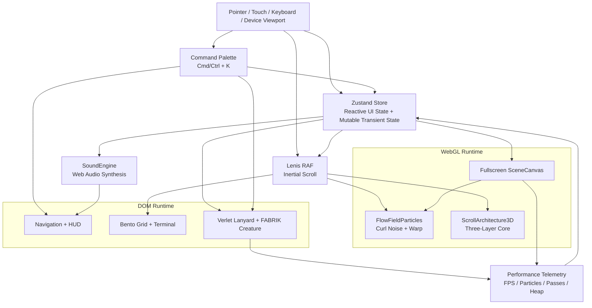
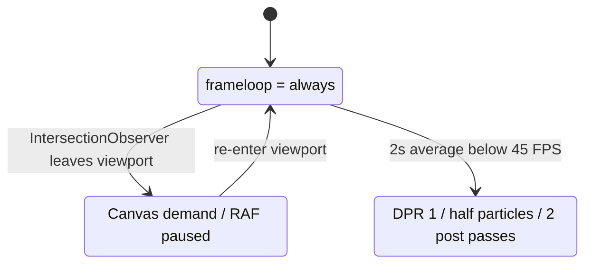

<div align="center">

# NODE/01

**3D & PHYSICS INTERACTIVE DIGITAL SHOWROOM**

一个融合 Apple 发布会级空间叙事、NVIDIA 工程可视化语汇与实时程序化物理的个人数字展厅。项目将 WebGL 粒子、三层架构演出、Bento 数据界面、Verlet 工牌与 FABRIK 机械生物压缩进同一个沉浸式运行时。

[](https://react.dev/)
[](https://www.typescriptlang.org/)
[](https://threejs.org/)
[](https://motion.dev/)
[](https://developer.mozilla.org/docs/Web/API/Web_Audio_API)
[](https://vite.dev/)

```text
SYSTEM STATUS  // ONLINE
RENDER PIPELINE // R3F + WEBGL
INPUT CHANNELS  // POINTER + TOUCH + KEYBOARD
DEPLOY TARGET   // GITHUB PAGES
```

</div>

---

## 系统拓扑



### 渲染生命周期



## 技术栈

| Layer | Engineering |
| --- | --- |
| UI | React 19, TypeScript 7, Tailwind CSS 4 |
| 3D | Three.js, React Three Fiber, Drei, postprocessing |
| Motion | Framer Motion, Lenis |
| State | Zustand reactive state + non-reactive mutable transient snapshot |
| Audio | Web Audio API: oscillators, noise buffers, filters, compressor, analyser |
| Physics | Hand-written Verlet, OBB collision, FABRIK IK, procedural gait |
| Delivery | Vite, GitHub Actions, GitHub Pages |

## 核心能力

- 8000 粒子的 Curl Noise 流场，medium tier 自动降级至 4000。
- 鼠标射线平面斥力、欠阻尼弹簧回归与滚动速度驱动的 Warp Speed 拉伸。
- 300vh Sticky 三层 AI 架构叙事、滚动拆解、相机轨迹与可点击 HUD。
- Verlet 工牌、12 轮约束松弛、OBB 碰撞、可断裂挂绳与一键重铸。
- FABRIK 六轴机械臂、12 节点柔性躯干和对角线 Trot 四足步态。
- 程序化合成音效、实时五频段频谱与 Web Audio 动态压缩。
- `AnalyserNode` 音频包络驱动的星尘、极光、体积光与架构呼吸响应。
- `Cmd/Ctrl + K` 模糊命令面板、主题切换、重力环境与简历 JSON 导出。
- 视口休眠、自适应画质、4K 首帧降级和 `Shift + D` 性能遥测。

### 电影级光效系统

1. **3D 旋度星尘尾迹**：Curl Noise 粒子流、鼠标射线斥力、Warp Speed 拉伸与多层光带。
2. **丁达尔体积光与焦散**：动态光束、体积尘埃、程序化地面焦散与棱镜色散。
3. **Bento 双彗星流光与萤火**：双层环绕流光、卡片粒子池、数据脉冲路径与音频响应。
4. **物理碰撞切向火花与分形电弧**：速度拉伸金属火花、二次弹跳分裂、绳索断裂分形电弧与灼烧等离子。
5. **电影级动态色散与数字极光**：五阶 fBm 极光、mipmap Bloom、动态色差、暗角、胶片颗粒与三套 VFX 光谱预设。

## 核心物理模型

### Verlet 积分

```math
x_{t+\Delta t} = x_t + (x_t - x_{t-\Delta t})(1-d) + a\Delta t^2
```

其中 `d` 为速度阻尼，重力与风力共同构成加速度 `a`。挂绳每帧执行 12 次距离约束松弛。

### 距离约束

```math
C = \frac{\lVert p_i-p_{i+1}\rVert-L_0}{L_0}
```

当形变率 `C > 2.5` 且持续超过断裂宽限期时触发绳索崩断。

### 复合风场

```math
F_{\text{wind}}(t) = A\sin(\omega_1t)\cos(\omega_2t)
```

每个质点使用不同相位，使挂绳在无交互状态下依然保持自然、非周期性的微摆动。

### FABRIK

前向阶段将末端关节贴合目标，后向阶段保持根节点固定并恢复各骨骼长度：

```math
p_i = p_{i+1} + \frac{p_i-p_{i+1}}{\lVert p_i-p_{i+1}\rVert}L_i
```

每轮后应用 Angle Cone Constraint，最终以末端误差小于 `tolerance` 或达到最大迭代次数为收敛条件。

### OBB 弹性冲量

```math
j = \frac{-(1+e)v_{\text{rel}}\cdot n}{m_A^{-1}+m_B^{-1}}
```

碰撞法线由 4 条分离轴检测得到；冲量再叠加切向摩擦，驱动工牌之间的动量传递。

### 粒子回归弹簧

```math
a = -k(p-p_0) - cv
```

粒子离开鼠标影响半径后，以欠阻尼弹簧方程回归原轨道；速度越高，颜色越接近紫色与白色高光。

## 性能预算

| Tier | DPR | Particles | Post Processing | Trigger |
| --- | --- | --- | --- | --- |
| High | 1-2 | 8000 flow + 4000 cursor + 1500 volumetric | Bloom + Chromatic Aberration + Vignette + Noise | 低负载桌面设备 |
| Medium / Mobile | 1 | 4000 flow + 2000 cursor + 750 volumetric | Bloom + Vignette | 4K / 手机 / 核显 / sustained <45 FPS |

物理沙盒与架构 Canvas 离开视口后立即停止 RAF 或切换为 `frameloop="demand"`。所有自定义 `BufferGeometry`、`TubeGeometry`、`ShaderMaterial`、`MeshBasicMaterial` 和 `InstancedMesh` 均在 `useEffect` 清理函数中显式释放。

`Shift + D` 遥测浮层实时汇总各场景活跃粒子源、当前后期 Shader Pass 数量、物理求解耗时、JS Heap 与当前 `vfxPreset`。

## 快捷操作

| Shortcut | Action |
| --- | --- |
| `Cmd/Ctrl + K` | 打开全局命令面板 |
| `Shift + D` | 打开性能遥测 |
| `↑` / `↓` | 命令面板选择 |
| `Enter` | 执行当前命令 |
| `Esc` | 关闭命令面板 |

移动端使用导航栏搜索图标打开命令面板。工牌拖拽期间会锁定 `touch-action`、Lenis 与页面 overscroll。

## 目录结构

```text
interactive-showroom/
├─ .github/workflows/deploy.yml
├─ scripts/
│  ├─ architecture-focus-check.py
│  ├─ command-mobile-check.py
│  ├─ fabrik-creature-check.py
│  ├─ performance-audit-check.py
│  ├─ vram-leak-audit.py
│  ├─ cinematic-vfx-check.py
│  ├─ sandbox-vfx-check.py
│  ├─ cursor-stardust-check.py
│  ├─ card-particle-check.py
│  ├─ sound-engine-check.py
│  ├─ verlet-sandbox-check.py
│  └─ visual-check.py
├─ src/
│  ├─ components/
│  │  ├─ bento/
│  │  ├─ canvas/
│  │  ├─ command/
│  │  ├─ layout/
│  │  └─ sandbox/
│  ├─ data/
│  ├─ hooks/
│  ├─ store/
│  ├─ styles/
│  └─ utils/
├─ vite.config.ts
└─ package.json
```

## 本地运行

要求 Node.js 22+。

```bash
npm ci
npm run dev
```

开发服务器默认地址：

```text
http://127.0.0.1:5173
```

## 工程质量门禁

```bash
# Root + app + Vite config TypeScript checks
npm run typecheck

# Production bundle only
npm run build:only

# Typecheck + production build
npm run build

# Local production preview
npm run preview
```

浏览器回归脚本使用 Playwright：

```bash
python scripts/visual-check.py artifacts/visual all
python scripts/command-mobile-check.py artifacts/command-mobile
python scripts/performance-audit-check.py artifacts/performance
python scripts/vram-leak-audit.py artifacts/vram-leak-audit
python scripts/verlet-sandbox-check.py artifacts/verlet
python scripts/fabrik-creature-check.py artifacts/fabrik
python scripts/architecture-focus-check.py artifacts/architecture
python scripts/cinematic-vfx-check.py artifacts/cinematic-vfx
python scripts/sandbox-vfx-check.py artifacts/sandbox-vfx
python scripts/cursor-stardust-check.py artifacts/cursor-stardust
python scripts/card-particle-check.py artifacts/card-particle
python scripts/sound-engine-check.py artifacts/sound
```

## GitHub Pages 部署

推送到 `main` 会触发 [`.github/workflows/deploy.yml`](.github/workflows/deploy.yml)：

1. `actions/setup-node` 使用 `package-lock.json` 缓存 npm 依赖。
2. `npm ci` 安装锁定版本。
3. `npm run typecheck` 执行完整 TypeScript 检查。
4. `npm run build:only` 生成生产构建。
5. `upload-pages-artifact` 与 `deploy-pages` 发布 `dist/`。

首次部署前，在仓库 **Settings → Pages → Build and deployment** 中将 Source 设为 **GitHub Actions**。Vite 使用相对 `base: './'`，兼容用户主页与项目子路径部署。

---

<div align="center">

`BUILD. OBSERVE. ITERATE.`

**NODE/01 / 2026**

</div>
