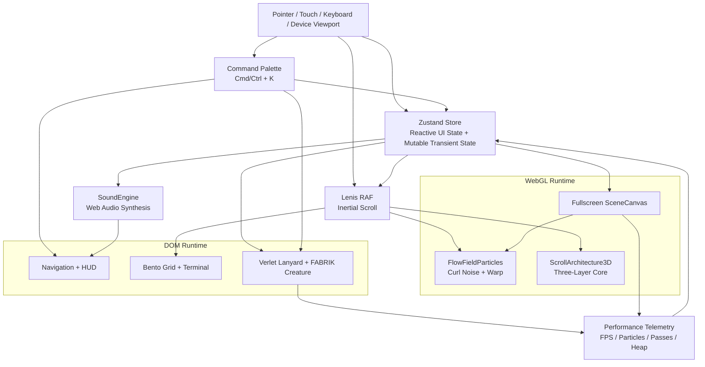
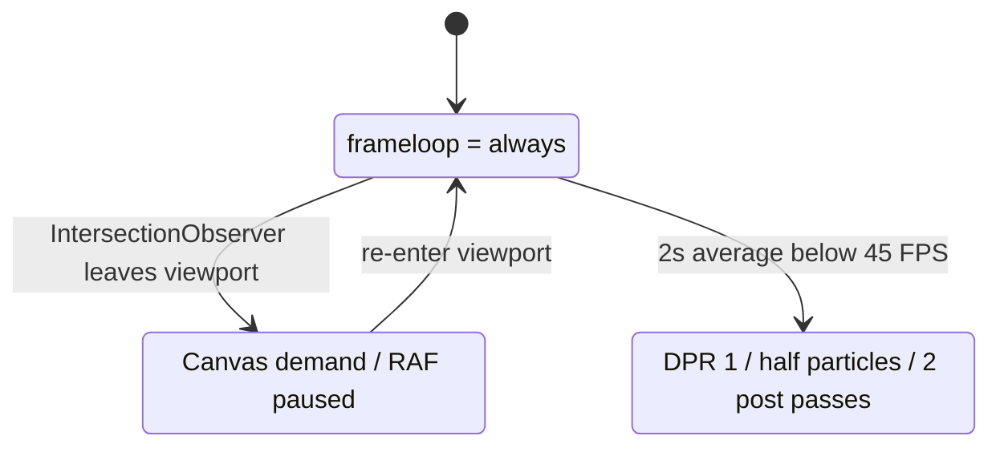

<div align="center">

# NODE/01

**3D & PHYSICS INTERACTIVE DIGITAL SHOWROOM**

一个融合 Apple 发布会级空间叙事、NVIDIA 工程可视化语汇与实时程序化物理的个人数字展厅。项目将 WebGL 粒子、三层架构演出、Bento 数据界面、Verlet 工牌与 FABRIK 机械生物压缩进同一个沉浸式运行时。

[](https://react.dev/)
[](https://www.typescriptlang.org/)
[](https://threejs.org/)
[](https://motion.dev/)
[](https://developer.mozilla.org/docs/Web/API/Web_Audio_API)
[](https://vite.dev/)

```text
SYSTEM STATUS  // ONLINE
RENDER PIPELINE // R3F + WEBGL
INPUT CHANNELS  // POINTER + TOUCH + KEYBOARD
DEPLOY TARGET   // GITHUB PAGES
```

</div>

---

## 系统拓扑



### 渲染生命周期



## 技术栈

| Layer | Engineering |
| --- | --- |
| UI | React 19, TypeScript 7, Tailwind CSS 4 |
| 3D | Three.js, React Three Fiber, Drei, postprocessing |
| Motion | Framer Motion, Lenis |
| State | Zustand reactive state + non-reactive mutable transient snapshot |
| Audio | Web Audio API: oscillators, noise buffers, filters, compressor, analyser |
| Physics | Hand-written Verlet, OBB collision, FABRIK IK, procedural gait |
| Browser Translation | translation-resilience DOM re-adoption + root render recovery |
| Delivery | Vite, GitHub Actions, GitHub Pages |

## 核心能力

- 8000 粒子的 Curl Noise 流场，medium tier 自动降级至 4000。
- 鼠标射线平面斥力、欠阻尼弹簧回归与滚动速度驱动的 Warp Speed 拉伸。
- 300vh Sticky 三层 AI 架构叙事、滚动拆解、相机轨迹与可点击 HUD。
- Verlet 工牌、12 轮约束松弛、OBB 碰撞、可断裂挂绳与一键重铸。
- FABRIK 六轴机械臂、固定长度枪口激光、12 节点柔性躯干和对角线 Trot 四足步态。
- 程序化合成音效、实时五频段频谱与 Web Audio 动态压缩。
- `AnalyserNode` 音频包络驱动的星尘、极光、体积光与架构呼吸响应。
- 8 座光学与计算架构展台在橱窗阶段使用合成层轻量循环预览，不创建 WebGL；进入暗房时仅按需挂载当前展品的一个 Canvas / View，关闭后立即卸载并释放上下文。
- 类型安全的 English / 中文双语系统，默认英文，支持本地持久化、动态页面元数据与全站文案切换。
- `Cmd/Ctrl + K` 模糊命令面板、主题切换、重力环境与简历 JSON 导出。
- 视口休眠、自适应画质、4K 首帧降级和 `Shift + D` 性能遥测。
- 浏览器整页翻译兼容：自动修复翻译器替换 React 文本节点造成的 DOM 位移，并提供根级错误恢复界面，避免黑屏。
- 全站区块导航统一写入 hash 并保留查询参数；刷新、分享深链接以及浏览器前进/后退都能恢复对应区块，普通滚动只更新导航高亮而不污染历史记录。
- `prefers-reduced-motion: reduce` 会关闭首页色差与噪声后期效果，把展馆 Shader / 粒子时间缩放至 `0.12x`，并让自动光学巡礼默认停在第 1 站，等待用户主动继续。

### 电影级光效系统

1. **3D 旋度星尘尾迹**：Curl Noise 粒子流、鼠标射线斥力、Warp Speed 拉伸与多层光带。
2. **丁达尔体积光与焦散**：动态光束、体积尘埃、程序化地面焦散与棱镜色散。
3. **Bento 双彗星流光与萤火**：双层环绕流光、卡片粒子池、数据脉冲路径与音频响应。
4. **物理碰撞切向火花与分形电弧**：速度拉伸金属火花、二次弹跳分裂、绳索断裂分形电弧与灼烧等离子。
5. **电影级动态色散与数字极光**：五阶 fBm 极光、mipmap Bloom、动态色差、暗角、胶片颗粒与三套 VFX 光谱预设。

### Optical & Computing Sandbox Gallery（八大交互式光学与硬核算法发光沙盘）

- 8 个独立展品覆盖递归弹射、分束、色散、焦散、偏振、衍射、量子发射与相位拓扑。
- 1. **色散棱镜焦散（Prism Caustics）**：旋转晶体折射白光，实时生成 RGB 色散扇、曲面接收屏、伏罗诺伊焦散和可拖拽发射器；越过临界角后会进入全内反射路径。
- 2. **全息激光扫描（Laser Scan Hologram）**：四轴扫描门架驱动全息切片，可在陀螺核心、赛博头骨与涡轮转子之间切换，并通过点击触发故障重构。
- 3. **万级粒子流形凝聚（Particle Morph）**：20,000 个 GPU 粒子在莫比乌斯环、双螺旋、三叶结、斐波那契球和晶圆城市之间连续形变，支持引力吸积与超新星冲击反馈。
- 4. **托卡马克聚变电弧核心（Plasma Reactor）**：三轴万向节磁环、分形电弧与六边形力场护盾共同构成聚变核心；点击护盾产生球面蜂窝涟漪，临界超频会释放等离子冲击波。
- 5. **递归光线追踪迷宫（Ray Bounce Maze）**：双平面镜、50/50 分束立方、色散棱镜与三座量子接收靶组成可拖拽光学沙盘，10 层递归求解器实时生成体积光束、分束树和锁定功率。
- 6. **声光律动频谱舞台（Audio Spectrum Stage）**：内置五声音阶琶音器与 `AnalyserNode`，以 256 根实例化光子柱、环形日冕频谱和 3D 瀑布地形响应音频，并提供八枚交互光琴键。
- 7. **3D 神经网络脉冲与反向传播沙盘（Neural Pulse Transformer）**：五层 Transformer 拓扑、600 颗贝塞尔突触光子和多头注意力光束支持正向推理、反向梯度波与单神经元隔离检视。
- 8. **GPU Tensor/RT Core 算力矩阵（GPU Compute Matrix）**：512 体素 GEMM 魔方、HBM/NVLink 流光总线、实时热力光谱、CUDA Warp 展开与 15 节点 BVH 光线遍历共同展示张量计算和光追加速管线。
- 光线弹射迷宫使用最大 10 层的 CPU 递归求解器，以实例化体积光柱、流动光子脉冲和星芒反馈实时重构整棵光路树；靶心锁定会换算实时接收功率并触发庆贺粒子，三套拓扑可在 0.9 秒内平滑重排。
- 声光频谱舞台内置五声音阶 / 大七和弦琶音器与 `fftSize: 512` 分析链，可在 16 × 16 矩阵光柱、环形极坐标日冕和滚动的 3D 频谱瀑布地形间切换；暗房八度光琴键会实时合成和弦，并把对应色彩的径向冲击波送过整个舞台。
- 神经脉冲沙盘以五层 Transformer 拓扑连接 8 个输入 Token、4 组彩色多头注意力簇、两层各 16 个隐藏神经元和 8 个输出 Logit 能量塔；600 颗实例化光子沿 224 条三次贝塞尔突触递归换乘，支持正向推理与反向传播双模式，并在反传阶段以赤金/霓虹紫梯度光纤逆流展示 `Δw = -η∇L`。隐藏神经元悬停或点击后会把无关连接压至 10%，并显示 GeLU / Swish 激活曲线与实时激活值的全息隔离卡。
- GPU 算力矩阵在暗黑硅片上铺开 360 颗 HBM / NVLink 总线粒子，以 512 个实例化光晶构成 `8 × 8 × 8` Tensor Core GEMM 魔方；翡翠 A 与赛博蓝 B 扫描面相交时逐点爆出白金结果，并汇入 128 颗累加器光子流。`10%–100%` 算力负载会同步抬高扫描频率、总线速度、硅片与魔方热场，并实时显示模拟 TFLOPS / HBM 带宽；点击任意体素可展开由单个实例化网格绘制的 32 线程 CUDA Warp。切换到 RT Core 后会改为实时遍历 15 节点 BVH 层次树，命中包围盒由冷蓝升级为高亮绿。
- `OpticalTourDirector` 提供 8 座展台 × 6 秒的全馆电影巡礼，每站第 2 秒自动调用专属高潮动作；支持暂停、跳过、暗房连续导览和全局命令启动。底部 Quick-Dock 会在展馆或暗房中浮现 8 枚发光徽章、当前公式与瞬时切换入口。
- 展馆橱窗不再同时创建 8 个 Drei `View`：8 个展品使用 CSS / SVG 合成层循环预览，并响应全站主题、巡礼聚焦与高潮状态；暗房只为当前展品按需挂载一个 WebGL Canvas / View。
- 展台预览仅保留轻量指针光晕与快捷参数；真实 Shader、粒子、物理和拖拽交互在进入暗房后才加载。暗房提供左键环绕、右键平移、滚轮缩放和展品级参数滑杆。
- 暗房支持 `380–750 nm` 物理光谱拾色、左右方向键切换展品，以及标准、高能、慢镜头三组一键预设。
- 顶部三套全站 VFX 预设会逐帧插值到全部全息底座刻度环、环境光、追光锥体与默认激光色，不会出现硬切闪烁。
- 暗房右上角的 Cinema Clean View 可通过按钮或 `H` 切入完全隔离的沉浸视口，隐藏导航、参数面板、巡礼 HUD 与 Quick-Dock；桌面按 `Esc` 或 `H` 返回，触屏可点右上角低干扰图标退出。

**全屏暗房调参台使用说明**

1. 在任意展台底部点击 `Enter Optical Darkroom`，或使用底部 Quick-Dock 切换展品。
2. 在 3D 视口中左键环绕、右键平移、滚轮缩放；方向键可切换上一件或下一件展品。
3. 右侧参数矩阵实时驱动当前展品的 Shader、粒子、音频或算法状态，标准 / 高能 / 慢镜头预设可一键恢复计算节奏。
4. 光谱滑杆提供 `380–750 nm` 物理波长映射；展品专属控制区提供反应堆超频、光路拓扑、八度光琴键、神经网络推理和 GPU 负载等交互。
5. 按 `H` 或点击右上角眼睛按钮进入 Cinema Clean View，按 `Esc` 先退出纯享模式，再次按 `Esc` 关闭暗房。

## 核心物理模型

### Verlet 积分

```math
x_{t+\Delta t} = x_t + (x_t - x_{t-\Delta t})(1-d) + a\Delta t^2
```

其中 `d` 为速度阻尼，重力与风力共同构成加速度 `a`。挂绳每帧执行 12 次距离约束松弛。

### 距离约束

```math
C = \frac{\lVert p_i-p_{i+1}\rVert-L_0}{L_0}
```

当形变率 `C > 2.5` 且持续超过断裂宽限期时触发绳索崩断。

### 复合风场

```math
F_{\text{wind}}(t) = A\sin(\omega_1t)\cos(\omega_2t)
```

每个质点使用不同相位，使挂绳在无交互状态下依然保持自然、非周期性的微摆动。

### FABRIK

前向阶段将末端关节贴合目标，后向阶段保持根节点固定并恢复各骨骼长度：

```math
p_i = p_{i+1} + \frac{p_i-p_{i+1}}{\lVert p_i-p_{i+1}\rVert}L_i
```

每轮后应用 Angle Cone Constraint，最终以末端误差小于 `tolerance` 或达到最大迭代次数为收敛条件。

### OBB 弹性冲量

```math
j = \frac{-(1+e)v_{\text{rel}}\cdot n}{m_A^{-1}+m_B^{-1}}
```

碰撞法线由 4 条分离轴检测得到；冲量再叠加切向摩擦，驱动工牌之间的动量传递。

### 粒子回归弹簧

```math
a = -k(p-p_0) - cv
```

粒子离开鼠标影响半径后，以欠阻尼弹簧方程回归原轨道；速度越高，颜色越接近紫色与白色高光。

## 性能预算

| Tier | DPR | Particles | Post Processing | Trigger |
| --- | --- | --- | --- | --- |
| High | 1-1.5 | 8000 flow + 4000 cursor + 1500 volumetric | Bloom + Chromatic Aberration + Vignette + Noise | 低负载桌面设备 |
| Medium / Mobile | 1 | 4000 flow + 2000 cursor + 750 volumetric | Bloom + Vignette | 4K / 手机 / 核显 / sustained <45 FPS |

光学展馆橱窗阶段保持 `0 Canvas / 0 View`，只有浏览器视口内的轻量预览运行 CSS 动画；进入暗房后仅创建 `1 Canvas / 1 View`，关闭暗房时整个 Canvas 被卸载。物理沙盒与架构 Canvas 离开视口后立即停止 RAF 或切换为 `frameloop="demand"`。所有自定义 `BufferGeometry`、`TubeGeometry`、`ShaderMaterial`、`MeshBasicMaterial` 和 `InstancedMesh` 均在 `useEffect` 清理函数中显式释放。

滚动使用原生 Wheel 响应，不再对主线程做惯性插值。滚动期间仅暂停装饰动画、隐藏全屏胶片混合层，并停用固定导航与导览坞的背景模糊；Bento 卡片离屏时停止流光和实时数据刷新，但不使用会触发滚动高度重算的 `content-visibility` 自动跳过。导航进度改为单个元素上的局部 transform 更新，避免每帧写入根级 CSS 变量引发全页样式重算。300vh 架构区的 WebGL Canvas 会在距离视口 `600px` 时才初始化。

`Shift + D` 遥测浮层实时汇总各场景活跃粒子源、当前后期 Shader Pass 数量、物理求解耗时、JS Heap、当前 `vfxPreset`、正在检视的光学展台名称与活跃 WebGL 视口数。

### 渐进加载与工程预算

- `DeferredSection` 通过 `IntersectionObserver` 按区块邻近视口时才挂载 `BentoGrid`、光学展馆、共享 WebGL Canvas、暗房、架构场景、Verlet 工牌和 FABRIK 机械生物；首屏不会提前请求这些重组件对应的独立 chunk。
- 每个延迟区块保留稳定的 DOM `id`，因此带 hash 的深链接、直接定位和巡礼自动聚焦不会因为组件尚未挂载而失效。
- 共享 `frameScheduler` 统一驱动 Lenis、滚动进度和遥测采样；页面进入后台后停止 RAF，诊断属性仅在开启诊断时写入，避免持续造成主线程与 DOM 抖动。
- 移动端 Quick-Dock 默认折叠为单行状态条，展开后使用 4 × 2 徽章布局；所有触控目标至少 `44 × 44px`，并通过 `env(safe-area-inset-bottom)` 与暗房底部保留区避开手机安全区。
- `npm run build` 会在生产打包后执行 `npm run check:bundle`。当前门禁上限为入口 JS `100 KB gzip`、首屏 JS `500 KB gzip`、CSS `35 KB gzip`、字体 `140 KB`；超出任一预算会直接使构建失败。

## 快捷操作

| Shortcut | Action |
| --- | --- |
| `Cmd/Ctrl + K` | 打开全局命令面板 |
| `Shift + D` | 打开性能遥测 |
| `↑` / `↓` | 命令面板选择 |
| `Enter` | 执行当前命令 |
| `Esc` | 关闭命令面板 |

移动端使用导航栏搜索图标打开命令面板。工牌拖拽期间会锁定 `touch-action`、Lenis 与页面 overscroll。

## 目录结构

```text
interactive-showroom/
├─ .github/workflows/deploy.yml
├─ scripts/
│  ├─ architecture-focus-check.py
│  ├─ command-mobile-check.py
│  ├─ fabrik-creature-check.py
│  ├─ performance-audit-check.py
│  ├─ vram-leak-audit.py
│  ├─ cinematic-vfx-check.py
│  ├─ sandbox-vfx-check.py
│  ├─ cursor-stardust-check.py
│  ├─ card-particle-check.py
│  ├─ gallery-check.py
│  ├─ ray-bounce-maze-check.py
│  ├─ audio-spectrum-stage-check.py
│  ├─ neural-pulse-sandbox-check.py
│  ├─ gpu-compute-matrix-check.py
│  ├─ optical-tour-director-check.py
│  ├─ optical-theme-clean-view-check.py
│  ├─ scroll-performance-check.py
│  ├─ translation-resilience-check.py
│  ├─ sound-engine-check.py
│  ├─ verlet-sandbox-check.py
│  └─ visual-check.py
├─ src/
│  ├─ components/
│  │  ├─ bento/
│  │  ├─ canvas/
│  │  ├─ command/
│  │  ├─ gallery/
│  │  ├─ layout/
│  │  ├─ sandbox/
│  │  └─ ui/
│  ├─ data/
│  ├─ hooks/
│  ├─ i18n/
│  ├─ store/
│  ├─ styles/
│  └─ utils/
├─ vite.config.ts
└─ package.json
```

## 本地运行

要求 Node.js 22+。

```bash
npm ci
npm run dev
```

开发服务器默认地址：

```text
http://127.0.0.1:5173
```

## 工程质量门禁

```bash
# TypeScript: app, Vite/Vitest/Playwright config and tests
npm run typecheck

# Vitest unit tests
npm run test

# Playwright functional tests (system Chrome on local Windows/macOS)
npm run test:e2e

# axe-core accessibility gate
npm run test:a11y

# Full local gate: TypeScript + unit + Chromium E2E + axe
npm run check

# Production bundle only
npm run build:only

# Typecheck + production build
npm run build

# Local production preview
npm run preview
```

Playwright 默认在本地使用系统 Chrome，不硬编码浏览器路径；CI 使用仓库安装的 Chromium。Linux 或无 Chrome 环境可运行：

```bash
npx playwright install chromium
PLAYWRIGHT_CHANNEL=bundled npm run test:e2e
```

WebKit / Firefox 定时 smoke：

```bash
npx playwright install webkit firefox
npm run test:e2e:browsers
```

浏览器回归脚本使用 Playwright：

```bash
python scripts/visual-check.py artifacts/visual all
python scripts/command-mobile-check.py artifacts/command-mobile
python scripts/performance-audit-check.py artifacts/performance
python scripts/vram-leak-audit.py artifacts/vram-leak-audit
python scripts/verlet-sandbox-check.py artifacts/verlet
python scripts/fabrik-creature-check.py artifacts/fabrik
python scripts/architecture-focus-check.py artifacts/architecture
python scripts/cinematic-vfx-check.py artifacts/cinematic-vfx
python scripts/sandbox-vfx-check.py artifacts/sandbox-vfx
python scripts/cursor-stardust-check.py artifacts/cursor-stardust
python scripts/card-particle-check.py artifacts/card-particle
python scripts/gallery-check.py artifacts/gallery
python scripts/ray-bounce-maze-check.py artifacts/ray-bounce-maze
python scripts/audio-spectrum-stage-check.py artifacts/audio-spectrum-stage
python scripts/neural-pulse-sandbox-check.py artifacts/neural-pulse-sandbox
python scripts/gpu-compute-matrix-check.py artifacts/gpu-compute-matrix
python scripts/optical-tour-director-check.py artifacts/optical-tour-director
python scripts/optical-theme-clean-view-check.py artifacts/optical-theme-clean-view
python scripts/scroll-performance-check.py artifacts/scroll-performance
python scripts/translation-resilience-check.py artifacts/translation-resilience
python scripts/sound-engine-check.py artifacts/sound
python scripts/i18n-check.py artifacts/i18n
```

## GitHub Pages 部署

推送到 `main` 会触发 [`.github/workflows/deploy.yml`](.github/workflows/deploy.yml)：

1. `actions/setup-node` 使用 `package-lock.json` 缓存 npm 依赖。
2. `npm ci` 安装锁定版本。
3. 安装 Playwright Chromium 并运行 `npm run check`，覆盖 TypeScript、Vitest、Chromium E2E 与 axe。
4. `npm run build` 再次执行完整检查并生成生产构建。
5. `upload-pages-artifact` 与 `deploy-pages` 发布 `dist/`。

PR 和非 `main` 分支由 [`.github/workflows/ci.yml`](.github/workflows/ci.yml) 执行同一 Chromium 门禁；每周末额外运行 WebKit 与 Firefox smoke。

首次部署前，在仓库 **Settings → Pages → Build and deployment** 中将 Source 设为 **GitHub Actions**。Vite 使用相对 `base: './'`，兼容用户主页与项目子路径部署。

---

<div align="center">

`BUILD. OBSERVE. ITERATE.`

**NODE/01 / 2026**

</div>
